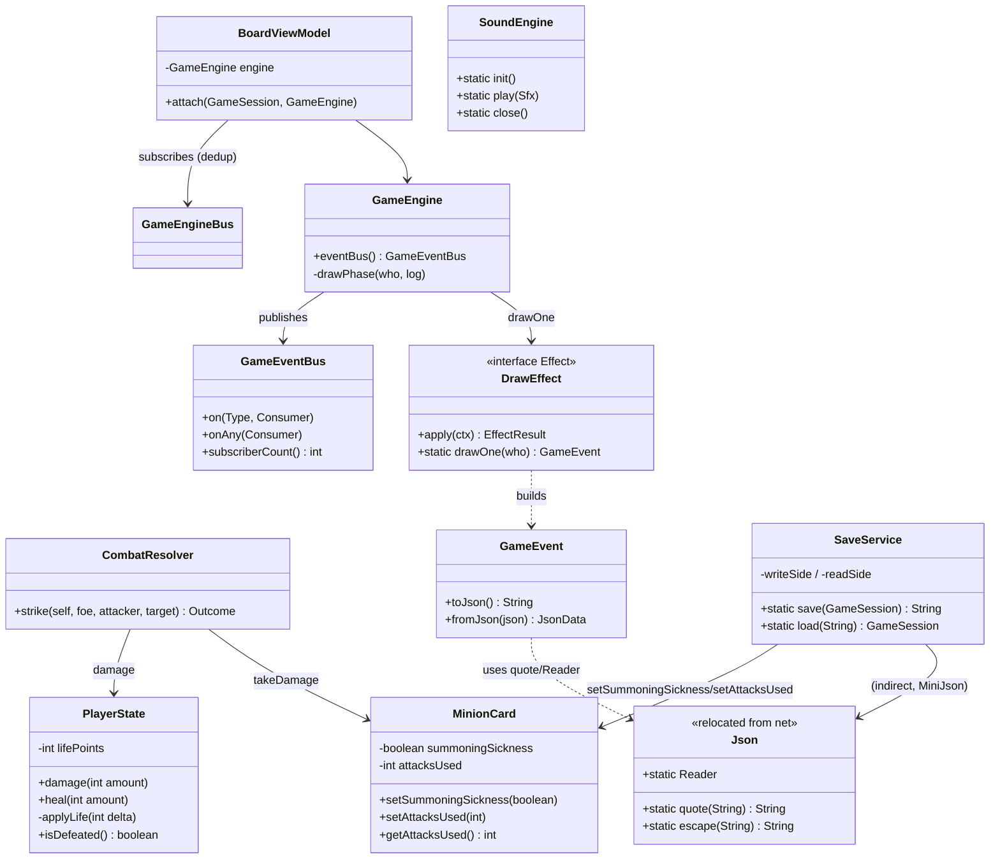
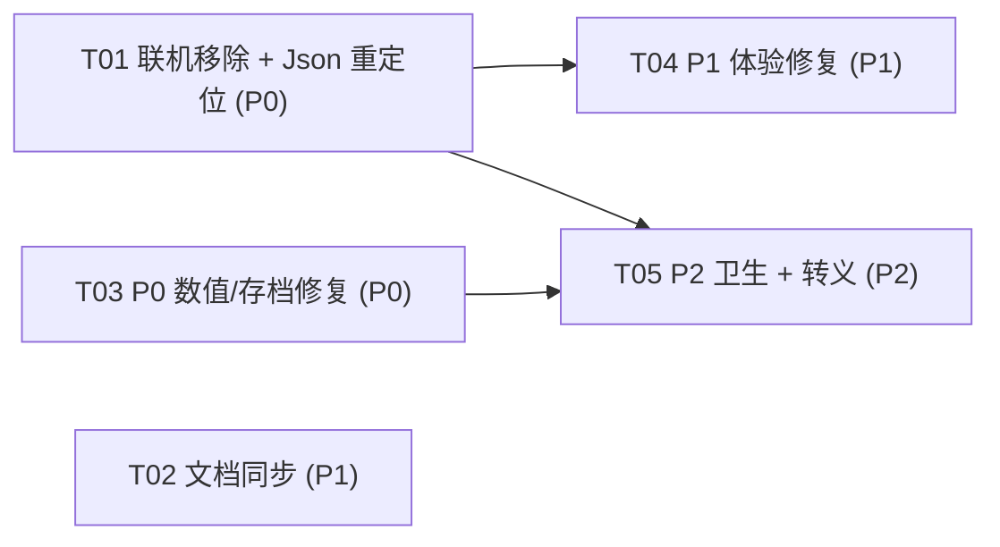

# DESIGN-singleplayer · CardGame 纯单机化增量设计（v1.6.0）

> 作者：高见远（架构师） · 面向：寇豆码（工程师）
> 上游：`docs/REQ-singleplayer.md`（R-00 ~ R-11）+ 主理人裁定的 4 个待确认问题 + 已核实的缺陷清单
> 定位：**既有项目范围收缩**，非新产品。功能面只减不增；不新增第三方依赖；不改 `pom.xml` 版本号。
> 纪律：本文件是唯一产出，未改动任何源码 / 测试 / 其它文档。

---

## §1 实现方案总览

一句话：**把联机整条链路（`net` / `server` / `client` / `MatchReferee` / 界面联机接线）从代码、测试、文档三层整体摘除；把会算错数、丢状态的 2 个 P0 缺陷用「单一出口 + 双向钳制」「存档字段增补」两处最小改动修掉；P1/P2 逐条落方法级修复。** 全程只删不加功能、不引依赖、不动 `pom.xml` 版本。

### 分层影响面

| 层 | 受影响 | 说明 |
|---|---|---|
| `model` | `PlayerState`、`MinionCard` | 生命钳制单一出口；随从补 `setAttacksUsed` |
| `engine` | `CombatResolver`、`GameEngine`、**删 `Phase`** | 打脸分支负攻钳制；抽牌管线抽公共方法 |
| `effect` | `DrawEffect` | 抽牌统一管线（发 DRAW / BURN 事件） |
| `data` | `MiniJson`（结论：不改） | 读取端已合规；写入端不在 data |
| `event` | `GameEvent`、**新增（迁移）`Json`** | `net/Json` 迁入 `event`（`GameEvent` 依赖它） |
| `service` | `SaveService`、`ConfigService`、**删 `MatchReferee`** | 存档字段增补；删空转配置 |
| `ui` | `CardGameApp`、`BoardViewModel`、`CardView`、`MinionView`、`HeroView`、`SoundEngine`、`AiTurnDirector`（不改）、两套主题 CSS | 摘除联机接线；订阅去重；置灰拦截；音效池加锁；色值入主题 |
| `net` / `server` / `client` | **整包删除** | R-00 |

### 三条被主理人裁定、本设计直接采信的口径
1. **R-11 撤销**：见 §3-R11——单机路径**不可达**「双方英雄同时归零」，不写代码。
2. **R-07 只迁关键可读项**：只迁 `MinionView:36-37`、`CardGameApp:1449,1481`，不做「硬编码色值零残留」重构。
3. **R-08 直接删**：`ConfigService` 的 `ai.level` / `ai.stepGapMs` 删除（运行时难度由下拉框 + `-Dai.level` 生效）。

### 一处必须澄清的关键依赖（会决定 R-00 的形态）
`event/GameEvent.java:6` **import 了 `org.example.card.net.Json`**，并在 `toJson()`（写事件 JSON，存档/回放用）与 `fromJson()`（读）里用到 `Json.quote` / `Json.Reader`。**`net/Json` 不能直接删除**，否则 `GameEvent` 编译不过、存档与回放全挂。
→ 本设计把 `net/Json.java` **迁移**为 `event/Json.java`（package `org.example.card.event`），其余 3 个 net 文件才删除。这与 REQ §2.2「移除 net 4 文件」差 1（Json 是「搬家」不是「消失」）；但因 R-08 会额外删除 `engine/Phase.java`，`src/main` 源文件数仍从 68 落到 **60**，命中 REQ §5 目标（详见 §8）。

---

## §2 联机移除清单（R-00）

> 「干净」定义见 REQ §4 的 8 条口径。下面按 **① 删除** / **② 修改引用点** 两类逐文件列到行号。

### ① 删除（整文件）

**`src/main`（8 → 删 7，迁 1）**

| 文件 | 处置 |
|---|---|
| `src/main/java/org/example/card/net/MessageCodec.java` | 删除 |
| `src/main/java/org/example/card/net/NetMessage.java` | 删除 |
| `src/main/java/org/example/card/net/Protocol.java` | 删除 |
| `src/main/java/org/example/card/net/Json.java` | **迁移** → `src/main/java/org/example/card/event/Json.java`（`package org.example.card.event;`），类名/方法体不动（R-10 的转义补丁在 T05 落在这个新家） |
| `src/main/java/org/example/card/server/GameRoom.java` | 删除 |
| `src/main/java/org/example/card/server/RoomServer.java` | 删除 |
| `src/main/java/org/example/card/client/RoomClient.java` | 删除 |
| `src/main/java/org/example/card/service/MatchReferee.java` | 删除 |
| `src/main/java/org/example/card/engine/Phase.java` | 删除（R-08，全类无引用） |

**`src/test`（删 5）**

| 文件 | 处置 |
|---|---|
| `src/test/java/org/example/card/net/ProtocolCodecTest.java` | 删除（12 用例） |
| `src/test/java/org/example/card/server/GameRoomTest.java` | 删除（18 用例） |
| `src/test/java/org/example/card/server/RoomServerTest.java` | 删除（3 用例） |
| `src/test/java/org/example/card/client/RoomClientTest.java` | 删除（2 用例） |
| `src/test/java/org/example/card/service/MatchRefereeTest.java` | 删除（2 用例） |

**`docs`（删 1）**

| 文件 | 处置 |
|---|---|
| `docs/NETWORK.md` | 删除 |

### ② 修改引用点（精确到行号）

**`event/GameEvent.java`**
- `:6` 删 `import org.example.card.net.Json;`（迁移后与 `Json` 同包，无需 import）。
- 其余不动：`EVENT_SCHEMA` 保持 `2`（v1 正文仍可解析，回放/存档格式零变化，不为「去联机」而降版本）。

**`ui/CardGameApp.java`（联机接线全部摘除）**

| 行 | 处置 |
|---|---|
| `:32-34` | 删 `import ...client.RoomClient; / ...net.NetMessage; / ...net.Protocol;` |
| `:131-139` | 删整段联机字段：注释 + `netClient` / `netButton` / `netLogSeen` / `ROOM_PORT` |
| `:308-311` | 删 `netButton` 创建与 `toggleNetwork()` 绑定 |
| `:335` | FlowPane 参数里去掉 `netButton` |
| `:493-495` | `openDeckBuilder()` 里删 `if (netClient != null) { log(...); }` 块 |
| `:527` | `startNewGame()` 里删 `closeNetwork(true);` |
| `:571-740` | 删整段联机方法：`toggleNetwork` / `askRoomAddress` / `startNetworkGame` / `adoptNetworkGame` / `networkChanged` / `closeNetwork`（含 `:587` `net.room`、`:590` 服务端提示、`:615` `net.name`） |
| `:849-858` | `playCard()` 里删 `if (netClient != null) { ... netClient.playCard(index); return; }` 块（`:849` 注释一并删） |
| `:980-983` | `attackMinion()` 路径删 `if (netClient != null) { sendNetworkAttack(...); return; }` |
| `:1004-1007` | `attackHero()` 路径删同款块 |
| `:1016-1032` | 删整个 `sendNetworkAttack(...)` 方法 |
| `:1070-1075` | `endYourTurn()` 里删 `if (netClient != null) { ... netClient.endTurn(); return; }` |
| `:1189-1192` | `loadGame()` 里删 `if (netClient != null) { log("联机模式下不能读档…"); return; }` |
| `:1239-1242` | `enterReplay()` 里删 `if (netClient != null) { log("联机模式下不能看回放…"); return; }` |
| `:1375-1382` | `announceGameOver()` 里 `if (netClient == null) { recorder.saveToFile(...) }` → 去掉条件，恒执行保存回放 |
| `:1383-1384` | `if (!isAutoplay() && netClient == null && engine != null)` → 去掉 `netClient == null` |
| `:776/793/812/840/930/1060` | `Color.web(...)` 是粒子/特效色，**不属 R-07 范围，保留** |

> 摘除后 `CardGameApp` 仍保留：`Platform`（`runAiTurn` 用）、`RANDOM`（`startNewGame` 用）、`SimpleAi`（建引擎用）等 import，无需再删。

**`service/HeadlessGameTest.java`（红线测试同步）**
- `:76` 删 `MatchReferee.class`。
- `:78-84` 删 `net.*` 全部 7 个类引用；新增 `org.example.card.event.Json.class` 与 `org.example.card.event.Json.Reader.class`（保住「事件 JSON 读写器零 JavaFX」这条红线）。
- `:86-87` 删 `server.GameRoom.class` / `server.RoomServer.class`。
- 其余（引擎/服务侧零 JavaFX 断言）不动。

**`README.md` / `docs/CHANGELOG.md` / `docs/BACKLOG.md` / `docs/PLAN-v1.5-v2.0.md`** —— 见 §5 的 T02（文档同步任务）。

**`pom.xml`** —— **无改动**（核对：无任何 net/server/client 依赖；`javafx-swing` 仍为截图所需，保留）。

### ③ 明确保留（易被误删，特此声明）
- `engine/GameSession.newVersus(...)` 与 `GameSession.Mode.PVP`：**保留**。它们被**未列入删除**的 `engine/SessionTest.java:157,179` 与 `ui/viewmodel/BoardViewModelTest.java:24` 使用；删除会连带改动保留测试，超出 R-00 范围，违背「只减不增 / 小巧玲珑」的性价比。REQ §4 口径 #1 只要求「无 net/server/client 包、无 MatchReferee」，`GameSession` 在 `engine` 包，不违反。
- `ui/viewmodel/BoardViewModel.setLocalSeat / localSeat`：保留（`BoardViewModelTest` 锁定）。

---

## §3 缺陷修复方案（R-01 ~ R-11）

> 每条给「问题定位 → 修复方案（方法级）→ 对既有测试的影响 → 新增回归用例要点」。

### R-01 负攻击力打脸不再回血（P0）
**定位**：`engine/CombatResolver.java:60-66` 打脸分支 `foe.damage(atk)`；`model/PlayerState.java:101-103` 的 `damage()` 仅 `Math.max(0, lifePoints - amount)`——`atk < 0` 时变成加血且可超 20。`data/CardDatabase.java:176` 允许宠物 `attackBonus ∈ [-5,5]`，叠加低攻随从即可触发。

**修复（方法级）**
1. `model/PlayerState.java`：引入**生命唯一出口**，双向钳制 `[0, START_LIFE]`：
   ```java
   private void applyLife(int delta) {
       lifePoints = Math.max(0, Math.min(START_LIFE, lifePoints + delta));
   }
   /** 伤害：非正值视为 0（不再反向回血），结果钳在 [0,20]。 */
   public void damage(int amount) { applyLife(-Math.max(0, amount)); }
   /** 治疗：非正值视为 0，结果钳在 [0,20]。 */
   public void heal(int amount)   { applyLife(Math.max(0, amount)); }
   ```
2. `engine/CombatResolver.java:60-66` 打脸分支：把「结算值」与「显示值」都钳到非负：
   ```java
   int atk = effectiveAttack(self, attacker);
   int dmg = Math.max(0, atk);           // 负攻 → 0 伤害
   foe.damage(dmg);
   String msg = attacker.getName() + " 直击敌方英雄 -" + dmg;
   events.add(GameEvent.attack(self, foe, attacker, null, dmg, msg));
   events.add(GameEvent.damage(foe, dmg, msg));
   ```
   互撞分支不动（`MinionCard.takeDamage` 已 `Math.max(0, amount)`，口径天然一致）。

**口径统一说明**：随从伤害走 `MinionCard.takeDamage`（`damageTaken += Math.max(0, amount)`），英雄伤害走 `PlayerState.damage`（`applyLife(-max(0,amount))`）——两者都「负值=0」，且英雄额外有 `[0,20]` 双向钳制。

**对既有测试的影响**：无破坏。`CombatEventOrderTest` 三条（`[ATTACK,DAMAGE]` / `[ATTACK,DAMAGE,DAMAGE,DEATH]` / `[ATTACK,DAMAGE,GAME_OVER]`）均为正值攻击，事件类型序列不变。`ReplayTest` 用正值剧本，`life = max(0,20-伤害)` 仍成立（钳制方向一致）。

**新增回归用例要点**（落 `engine/GameEngineTest.java`，现有文件）：
- 负攻随从直击敌方英雄：`foe.getLifePoints()` **不增**（等于原值），事件 `DAMAGE.amount == 0`。
- 满血英雄受「负攻」打脸：生命仍为 `START_LIFE`（不超 20）。
- 双向钳制：`damage(Integer.MAX_VALUE)` 后 `lifePoints == 0`；`heal(999)` 后 `== START_LIFE`；`damage(-5)` 后不变。

### R-02 读档保留召唤失调 / 已出手（P0）
**定位**：`service/SaveService.java:80-85` 战场只存 `id/damageTaken/shield`；`model/MinionCard.java:15` 默认 `summoningSickness = true`、`:17` `attacksUsed`；读档 `SaveService.java:139-155` 用 `freshCopy` 重建 → 己方随从全部回到「召唤失调 + 未出手」，当回合不能攻击。

**修复（方法级）**
1. `model/MinionCard.java`：新增读档恢复用 setter（`setSummoningSickness` 已有；补 `attacksUsed`）：
   ```java
   /** 读档恢复已出手次数（仅 SaveService 用）。 */
   public void setAttacksUsed(int attacksUsed) { this.attacksUsed = Math.max(0, attacksUsed); }
   ```
2. `service/SaveService.java:80-85`（写）：战场每张随从追加两个字段（沿用 shield 的「布尔存字符串」约定）：
   ```java
   out.append(",\"damageTaken\":").append(m.getDamageTaken());
   out.append(",\"shield\":").append(quote(Boolean.toString(m.hasDivineShield())));
   out.append(",\"sickness\":").append(quote(Boolean.toString(m.isSummoningSickness())));
   out.append(",\"attacksUsed\":").append(m.getAttacksUsed());
   ```
3. `service/SaveService.java:139-155`（读）：仿现有 `shield` 的 `field.contains(...)` 模式，**缺字段即老存档**，用兼容默认：
   ```java
   if (field.contains("sickness")) {
       minion.setSummoningSickness(bool(field, "sickness"));
   } else {
       minion.setSummoningSickness(false);   // 老存档：默认「可攻击」，修掉读档当回合全瘫
   }
   if (field.contains("attacksUsed")) {
       minion.setAttacksUsed((int) field.get("attacksUsed").asNumber().value());
   }                                          // 缺字段默认 0（本回合未出手）
   ```
   注意：`MiniJson.Obj` 的 `field.get(key)` 在键缺失时返回 `null`，所以 `attacksUsed` 分支要用 `field.contains` 保护后再 `get`。

**SAVE_VERSION 决策：不升级（保持 `= 1`）**。理由：本次是**纯加法**（新字段可选、老读端忽略；新读端对缺字段有默认值），老存档（`SaveCompatTest` 里的样例）与新存档都能互读；单机无「老二进制读新存档」的场景；且升级会破坏 `SaveCompatTest.java:88` 的 `replace("\"saveVersion\":1", "\"saveVersion\":999")`（升版后该串不再匹配，用例会失败），需额外改测试却零收益。故维持 `SaveService.java:26` 的 `SAVE_VERSION = 1` 与 `:28-29` 注释口径。

**对既有测试的影响**：`SaveCompatTest.assertSide` 未比较 `sickness/attacksUsed`，往返用例照过（且现在语义更正确）。`ReplayRecorderTest` 快照不含战场随从的这两个状态断言，照过。

**新增回归用例要点**（落 `service/SaveCompatTest.java`，现有文件）：
- 在 `dirtiedSession()` 里让上场的随从**保持召唤失调**（当前确实如此：刚上场未结束回合），并对其 `registerAttack()` 一次；`save→load` 后断言该随从 `isSummoningSickness()` 与 `getAttacksUsed()` 与存前一致。
- 老存档兼容：手工把一份新存档的 `,"sickness":"true"` 与 `,"attacksUsed":1` 两个片段删除，`load` 后断言 `isSummoningSickness()==false`、`getAttacksUsed()==0`（不抛异常）。

### R-03 视图模型订阅可注销 / 去重（P1）
**定位**：`ui/viewmodel/BoardViewModel.java:37-49` 每次 `attach` 都 `engine.eventBus().on(...)` + `onAny(...)`，从不注销；`ui/CardGameApp.java:1276`（回放每步）与 `:1341`（退出回放）对**同一个 live engine** 反复 `attach` → 监听器线性增长。`event/GameEventBus.java` **不提供取消订阅能力**。

**修复（方法级）——选「同引擎不重复订阅」的简单方案**
`BoardViewModel.attach(session, engine)` 增加引擎身份判断，只对**新引擎**订阅：
```java
public void attach(GameSession session, GameEngine engine) {
    boolean newEngine = (this.engine != engine);
    this.session = session;
    this.engine = engine;
    this.selectedAttacker = null;
    this.pendingDrawAnim.clear();
    if (newEngine) {
        engine.eventBus().on(GameEvent.Type.DRAW, e -> { ... });   // 原逻辑
        engine.eventBus().onAny(e -> touch());
    }
}
```
- 回放场景（`showReplay` / `exitReplay`）用的都是同一个 `engine` 实例 → 不再重复订阅，监听器数量恒定。
- 开新局/读档时 `engine = new GameEngine(...)`（`CardGameApp:535 / :1204`）→ 引擎实例变了 → 对新总线订阅一次；旧引擎被丢弃，其总线随之回收。

**为什么拒绝更重的方案**：给 `GameEventBus` 加「返回可取消的 `Subscription` 句柄」或 `off(...)`，需要新增类型/句柄生命周期管理，而唯一泄漏路径（同一引擎反复 attach）用一个 `!=` 判断即可根治——按「有简单方案选简单」原则取后者。**`GameEventBus` 的唯一扩展**：为回归测试加只读计数
```java
/** 测试用：当前订阅者总数（typed + any）。 */
public int subscriberCount() {
    int n = anyListeners.size();
    for (var list : listeners.values()) n += list.size();
    return n;
}
```

**对既有测试的影响**：`BoardViewModelTest` 现有 4 例（默认座位 / 座位 1 / 未知座位回退 / 可玩判断）逻辑不变，照过。

**新增回归用例要点**（落 `ui/viewmodel/BoardViewModelTest.java`）：
- `attach(session, engine)` 后记 `int before = engine.eventBus().subscriberCount()`；再次 `attach(session2, engine)`（同一引擎）→ 断言 `subscriberCount() == before`（不增长）。
- 换新引擎 `attach(session3, new GameEngine(...))` → 新引擎总线 `subscriberCount() == 2`（DRAW + any）。

### R-04 音效池线程安全 + 资源可关（P1）
**定位**：`ui/fx/SoundEngine.java:62-76` `ensurePool` 的 `POOL.containsKey` 与 `POOL.put` 都在锁外 → 预热线程与 UI 线程可同时通过 `containsKey`，后写 `put` 覆盖先前 `Deque<Clip>`，孤立 4 个 `Clip`（泄漏）；`:119-137` 的 `Clip` 与 `AudioInputStream` 从不关闭。

**修复（方法级）**
1. `ensurePool` 改**双检锁**（复用既有 `POOL_LOCK`，不再用 `synchronizedMap` 的隐式锁做 check-then-act）：
   ```java
   private static void ensurePool(Sfx sfx) {
       synchronized (POOL_LOCK) {
           if (POOL.containsKey(sfx)) return;
           try {
               byte[] pcm = synth(sfx);
               Deque<Clip> clips = new ArrayDeque<>();
               for (int i = 0; i < POOL_SIZE; i++) clips.add(open(pcm));
               POOL.put(sfx, clips);
           } catch (Exception ex) {
               // 单音效失败不影响其他音效
           }
       }
   }
   ```
   （`play()` 里 `POOL.get` / `clips.poll` / `clips.offer` 已包在 `synchronized (POOL_LOCK)` 内，保持；`Deque` 本身线程安全性由同一把锁保证。）
2. `open(byte[] pcm)` 里 `AudioInputStream` 用 **try-with-resources**（`clip.open(stream)` 会把数据读入内存，之后 stream 可关）：
   ```java
   try (AudioInputStream stream = new AudioInputStream(new ByteArrayInputStream(pcm), format, pcm.length / 2)) {
       Clip clip = AudioSystem.getClip();
       clip.open(stream);
       ... // 音量、LineListener 不变
       return clip;
   }
   ```
3. 新增生命周期收口 `close()`（幂等）：清空池并关闭每个 `Clip`：
   ```java
   /** 释放全部 Clip（幂等）。窗口退出或测试收尾调用。 */
   public static void close() {
       synchronized (POOL_LOCK) {
           for (Deque<Clip> clips : POOL.values()) {
               for (Clip clip : clips) { try { clip.stop(); clip.close(); } catch (Exception ignored) {} }
           }
           POOL.clear();
       }
   }
   ```
   调用点：`CardGameApp.stop()`（JavaFX 生命周期）里加 `SoundEngine.close();`（若已存在 `stop()` 则在其中追加；无则在类内新增 `@Override public void stop()`）。

**对既有测试的影响**：无（当前无音效测试）。

**新增回归用例要点**（新增 `ui/fx/SoundEngineTest.java`，设备容错）：
- `closeIsIdempotent`：`SoundEngine.init(); SoundEngine.close(); SoundEngine.close();` 不抛异常；`isEnabled/setEnabled` 往返正确。
- 无音频设备时（CI 常见）用 `Assumptions.assumeTrue(...)` 跳过「池被填充」的强断言，避免误红。

### R-05 过牌法术发 DRAW / BURN 事件（P1）
**定位**：`effect/DrawEffect.java:23-38` 直接把手牌/墓地写死，只发一条 `SPELL` 事件；对比 `engine/GameEngine.java:375-391` 的 `drawPhase` 会发 `DRAW` / `BURN`（含满手烧牌）。结果：过牌法术无抽牌音效、满手时静默烧牌。

**修复（方法级）——统一抽牌管线**
在 `effect/DrawEffect` 加一个**公共静态**「抽一张」出口（`engine` 已依赖 `effect`，反向依赖不成立，故放在 effect 侧）：
```java
/** 抽一张的唯一样板：满手烧进墓地发 BURN，否则进手牌发 DRAW；空堆返回 null。 */
public static GameEvent drawOne(PlayerState who) {
    Optional<Card> drawn = who.getDeck().draw();
    if (drawn.isEmpty()) return null;
    Card card = drawn.get();
    if (who.getHand().size() >= PlayerState.MAX_HAND) {
        who.getGraveyard().add(card);
        return GameEvent.burn(who, card, "手牌已满，烧掉：" + card);
    }
    who.getHand().add(card);
    return GameEvent.draw(who, card, "抽卡：+" + card);
}
```
- `engine/GameEngine.java:375-391` `drawPhase` 改为调 `DrawEffect.drawOne(self)`，并**逐字保留**原日志/事件文案（`"抽卡：+" + card`、`"手牌已满，烧掉：" + card`、空堆 `"牌堆已空，无牌可抽"`）——这样 `AiStepTurnTest` 的 `[TURN_START, DRAW]`、`SecondMoveBonusTest` 全部不动。
- `effect/DrawEffect.apply` 改为循环 `drawOne`，把非空事件收进结果，**并在最前保留原 `SPELL` 事件**：
  ```java
  List<GameEvent> events = new ArrayList<>();
  String msg = "法术：" + card.getName() + " 抽 " + card.getAmount() + " 张牌";
  events.add(GameEvent.spell(self, card, card.getAmount(), msg));
  for (int i = 0; i < card.getAmount(); i++) {
      GameEvent e = drawOne(self);
      if (e != null) events.add(e);
  }
  return new EffectResult(events, List.of(msg));   // logs 保持不变
  ```

**事件顺序**：法术结算统一为 `SPELL` 先、随后 `DRAW`/`BURN`，与 `DamageEffect` 的 `SPELL→DAMAGE` 同构；**不触碰** `CombatEventOrderTest` 锁定的攻击/直击序列。

**对既有测试的影响**：`effect/EffectRegistryTest.java:73-75` 的 `drawEffectMatchesOldSettlement` **需更新**：该用例牌堆有 2 张、会真的抽 2 张，故
- `:73-74` 事件断言 `[SPELL]` → `[SPELL, DRAW, DRAW]`；
- `:75` 日志断言 `["法术：奥术智慧 抽 2 张牌"]` **保持不变**（logs 未新增）。

**新增回归用例要点**（落 `effect/EffectRegistryTest.java`）：
- 满手过牌发 `BURN`：把手牌填到 `MAX_HAND` 再结算 DRAW 法术，断言事件含 `BURN`、墓地 +1、手牌不超上限。
- 空堆过牌：牌堆清空后结算，事件仅 `[SPELL]`、无异常。

### R-06 置灰卡牌真正拦截点击（P1）
**定位**：`ui/view/CardView.java:122-126` 的点击回调无条件触发 `onPlay`；`:137-143` 的 `setPlayable(false)` 只加 `card-disabled` 样式。

**修复（方法级）**
`CardView` 增加 `private boolean playable = true;`；点击回调加门禁；`setPlayable` 同步该字段：
```java
setOnMouseClicked(e -> { if (playable && onPlay != null) onPlay.run(); });

public void setPlayable(boolean playable) {
    this.playable = playable;
    if (playable) getStyleClass().remove("card-disabled");
    else if (!getStyleClass().contains("card-disabled")) getStyleClass().add("card-disabled");
}
```
（**不**用 `setDisable(true)`：它会连带禁用子树并触发 JavaFX 默认禁用态样式，与既有 `card-disabled` 视觉叠加，行为不可控；布尔门禁最小且语义清晰。）

**对既有测试的影响**：无（`CardView` 是 JavaFX 控件，headless 不实例化，无单测）。

**回归验证要点**：无法在无头单测里点控件——以**代码走查 + 手工/自动对局冒烟**验证（`-Dui.autoplay=10` 覆盖「费用不够置灰但不误触」路径不崩）。设计上已把门禁放在唯一入口，逻辑可一眼确认。

### R-07 硬编码色 / 字号迁入主题 CSS（P1）
**定位与范围**（按裁定 2，只迁影响亮色可读性者）：
- `ui/view/MinionView.java:36-37`：`inner.setFill(Color.web(own ? "#1e3222" : "#3a2430"))`、`setStroke(Color.web(own ? "#6fae7f" : "#b07a8a"))`。
- `ui/CardGameApp.java:1449`：成就 toast 内联 `-fx-text-fill: #f0c96b` 等。
- `ui/CardGameApp.java:1481`：中央横幅内联 `-fx-text-fill: <color>` + dropshadow。

**已确认无需改动**（口径澄清）：卡名走 `.card-name`、伤害数字走 `.damage-float` / `.heal-float`（`CardGameApp:1522` 用样式类，非内联）——亮色主题 CSS 已分别给出深色高对比配色，**无需迁移**。粒子/特效色（`:776/793/812/840/930/1060` 的 `Color.web`）不在本范围。

**修复（方法级）**
1. `MinionView`：把圆改为挂样式类，颜色交给 CSS：
   ```java
   Circle inner = new Circle(SIZE / 2 - 7);
   inner.getStyleClass().add(own ? "minion-inner-own" : "minion-inner-foe");
   inner.setStrokeWidth(1);
   inner.setMouseTransparent(true);
   ```
   两套 CSS 各加：
   ```css
   .minion-inner-own { -fx-fill: #1e3222; -fx-stroke: #6fae7f; }
   .minion-inner-foe { -fx-fill: #3a2430; -fx-stroke: #b07a8a; }
   ```
   （亮色主题给羊皮纸底适配的浅色系，保证压暗状态下仍可读。）
2. `CardGameApp.showToast`（`:1448-1452`）：改挂样式类 `.toast`，把原内联样式整体搬进两套 CSS：
   ```java
   Label toast = new Label(text);
   toast.getStyleClass().add("toast");
   ```
   ```css
   .toast { -fx-text-fill: #f0c96b; -fx-font-size: 20px; -fx-font-weight: bold;
            -fx-effect: dropshadow(gaussian, rgba(0,0,0,0.9), 8, 0.6, 0, 2);
            -fx-background-color: rgba(10, 8, 16, 0.85); -fx-background-radius: 8; -fx-padding: 4 14; }
   ```
   （亮色主题把 `-fx-text-fill` 换为深金 `#8a6a1a`、底色换浅色衬底，保证对比度。）
3. `CardGameApp.showBanner`（`:1475-1484`）：签名由「传色值」改为「传样式类」，调用点同步：
   - 方法：`private void showBanner(String text, String styleClass)`；`banner.getStyleClass().add(styleClass);`（删掉内联 `setStyle`）。
   - 调用点：`:820` → `"banner-gold"`；`:822` → `"banner-ai"`；`:1399` → `"banner-win"`；`:1407` → `"banner-lose"`。
   - 两套 CSS 定义 `.banner-gold/.banner-ai/.banner-win/.banner-lose`（含 `-fx-font-size: 46px`、`-fx-font-weight: bold`、`-fx-effect: dropshadow(...)`）。

**CSS 变量/类命名约定**：沿用现有「语义化样式类 + 每主题一份选择器」的模式（`ui/Theme` 是唯一真相源，两套 CSS 选择器一一对应），不引入 `-fx-` 自定义变量。

**对既有测试的影响**：`ThemeTest` / `AssetsCoverageTest` 只查样式表存在性与卡图，不解析 CSS 内容 → 不受影响。

**回归验证要点**：无头无法断言渲染——以**亮色主题截图**（`-Dui.screenshot=docs/screenshot-light.png -Dui.theme=light`）目视核对卡名/伤害数字/横幅对比度；命令见 §8。

### R-08 清理死代码与空转配置（P2）
**定位与修复**
- `engine/Phase.java`：整类无引用 → **删文件**。
- `service/ConfigService.java`：删 `:21` `aiLevel`、`:22` `aiStepGapMs` 字段；删 `:37-38` load 两行；删 `:49-50` save 两行；删 `:72-78` 两个 getter。（已核实：全仓无 `getAiLevel()` / `getAiStepGapMs()` 调用点，删除零影响。）
- `ui/view/HeroView.java`：删 `:33` `private int shownLife;`、`:37` `this.shownLife = ...`、`:127` `shownLife = life;`（只写不读）。
- `net/MessageCodec.java:240` 的 `requireBool`：随 R-00（文件删除）消失，无需单独处理。
- `ui/AiTurnDirector.java:24` `STEP_GAP = 420`：**保留**（按裁定，不新增配置项）。

**对既有测试的影响**：`ConfigThemeTest` 只用 `getThemeId/setThemeId`，不碰 ai 键，照过。

**回归验证要点**：编译通过即证明无残留引用；无需新增用例（死代码删除由「全量编译 + 单测」覆盖）。

### R-09 线程收口（P2）
**定位**：`ui/CardGameApp.java:1086-1098` `runAiTurn` 每次 `new Thread(...)`（非 daemon、无句柄、退出最多拖 500ms）。

**修复（方法级）——直接消灭线程**：用 JavaFX `PauseTransition` 替代「后台 sleep + `Platform.runLater`」，全部留在 UI 线程：
```java
private void runAiTurn() {
    final GameSession played = session;
    final int generation = played.getGeneration();
    var pause = new javafx.animation.PauseTransition(Duration.millis(500));
    pause.setOnFinished(e -> {
        if (session == played && generation == played.getGeneration()) {
            planAiTurn();
        }
    });
    pause.play();
}
```
（`Duration` 已 import；`PauseTransition` 用全限定名，与 `CardGameApp` 内既有写法一致。代数作废语义完全保留。）
`server/RoomServer.java:39,96-98` 的线程表问题随 R-00 消失。

**对既有测试的影响**：无（UI 线程调度，无单测）。

**回归验证要点**：`-Dui.autoplay=10` 整局冒烟 exit=0（覆盖 AI 回合调度）；退出无挂起线程。

### R-10 单机 JSON 转义缺口（P2）
**定位与结论（逐处回代码确认）**
- `data/MiniJson.java`（**读取端**）：`parseString` 已支持 `\b` `\f` `\u`，并**拒绝未转义控制字符**（`:384-401`、`:406-408`）→ **无缺口，不改**。
- `service/SaveService.quote`（`:111-113`，**写入端**）：只转义 `\` 与 `"`。**可达性结论：单机不可达**——它只用于引号化**卡牌 id**（`CardDatabase` 的 ASCII id）与**布尔字符串**；玩家名不入存档（`load` 固定用 `"你"/"AI"`），故不会出现控制字符。
- `net/Json.escape` / `Json.Reader`（迁移后 `event/Json.java`）：`escape` 缺 `\b/\f`（写成裸控制字符，产出**非法 JSON**）；`Reader.string` 也未识别 `\b/\f`。**可达性结论：可达但受开发控制**——`GameEvent` 的事件文案内嵌**卡牌名**（如 `"抽卡：+" + card`、`"法术：…" + card.getName()`），卡名来自 `src/main/resources/cards/*.json`，若卡名含 `\u0008` 等控制字符，则事件 JSON（写入 `last-replay.txt` / 存档事件流）会带非法字符。风险低（卡表由开发者维护），但修复极便宜。

**修复（方法级）**
1. `event/Json.java` `escape`（迁入后）：补齐控制字符转义——
   ```java
   case '"' -> out.append("\\\"");
   case '\\' -> out.append("\\\\");
   case '\n' -> out.append("\\n");
   case '\r' -> out.append("\\r");
   case '\t' -> out.append("\\t");
   case '\b' -> out.append("\\b");
   case '\f' -> out.append("\\f");
   default -> { if (ch < 0x20) out.append(String.format("\\u%04x", (int) ch)); else out.append(ch); }
   ```
2. `event/Json.java` `Reader.string()`：对称识别 `\b` `\f` 与 `\uXXXX`：
   ```java
   case 'b' -> '\b';
   case 'f' -> '\f';
   case 'u' -> /* 读 4 位十六进制 */ (char) Integer.parseInt(hex4, 16);
   default  -> throw error("非法转义 \\" + esc);
   ```
3. `service/SaveService.quote`（`:111-113`）：为**统一口径**同步补 `\b` `\f` 与其它 C0（即便当前不可达）：
   ```java
   private static String quote(String value) {
       StringBuilder sb = new StringBuilder("\"");
       for (char ch : value.toCharArray()) {
           switch (ch) {
               case '"'  -> sb.append("\\\"");
               case '\\' -> sb.append("\\\\");
               case '\n' -> sb.append("\\n");
               case '\r' -> sb.append("\\r");
               case '\t' -> sb.append("\\t");
               case '\b' -> sb.append("\\b");
               case '\f' -> sb.append("\\f");
               default   -> { if (ch < 0x20) sb.append(String.format("\\u%04x", (int) ch)); else sb.append(ch); }
           }
       }
       return sb.append('"').toString();
   }
   ```
   `MiniJson` 读取端已能解 `\b/\f/\u`，与写入端对称，闭环成立。

**对既有测试的影响**：`ReplayTest.specialCharactersRoundTrip`（`:120-125`）当前只测 `" \ \n`，仍通过；`SaveCompatTest` 不受影响。

**新增回归用例要点**
- `event/ReplayTest.java`：把 `specialCharactersRoundTrip` 的 message 扩为含 `\b` `\f`（如 `"退格\b换页\f"`），断言 `toJson→fromJson` 往返无损。
- `service/SaveCompatTest.java`：**结论性用例**——构造一个卡牌名含控制字符的场景不可行（卡表只读），故改为「引号化 id 的往返」保持现状，并在测试注释写明「SaveService 写入端当前不可达，补丁为防御性统一」。

### R-11 同归于尽判定 —— 结论：撤销，不写代码（P2）
**可达性判定（基于代码阅读）**
- 英雄掉血的**唯一来源**是：① `CombatResolver.strike` 的**打脸分支**——只对 `foe` 扣血，攻击方英雄不掉血；② `DamageEffect`——只对 `foe` 扣血；③ 治疗只作用于 `self`。**没有任何路径在单次结算里同时伤到双方英雄**（互撞只伤随从；宠物是常驻光环、不造成伤害；`TriggerSystem` 现有 `ON_SUMMON/ON_DEATH` 触发器不含双向打脸）。
- 胜负判定 `GameSession.gameOver()`（`:139-141`）= `player.isDefeated() || ai.isDefeated()`；引擎在每个动作后即停，`checkGameOver()`（`CardGameApp:1424-1433`）先判玩家、再判 AI。**一旦一方归零即终局**，不存在「双方同时归零」的观察点。

**结论**：单机路径**不可达**「双方英雄同时归零」，R-11 **撤销**（随 R-00 一并把联机侧的判负分支摘除即可）。不新增任何判定规则或代码；若将来引入「反伤/双向打脸」类效果，再重新立项。

---

## §4 数据结构与接口变更

### 4.1 签名变更一览

| 类 | 变更 | 说明 |
|---|---|---|
| `model.PlayerState` | 新增 `private void applyLife(int)`；`damage(int)` / `heal(int)` 改为经 `applyLife` 双向钳制 | 伤害/治疗唯一出口；对外签名不变 |
| `model.MinionCard` | 新增 `public void setAttacksUsed(int)` | 读档恢复 |
| `engine.CombatResolver` | `strike` 打脸分支内部逻辑变更（负攻→0） | 对外签名不变 |
| `engine.GameEngine` | `drawPhase` 内部改调 `DrawEffect.drawOne` | 对外签名不变 |
| `effect.DrawEffect` | 新增 `public static GameEvent drawOne(PlayerState)`；`apply` 逻辑变更 | 新公共静态方法 |
| `event.Json` | **迁移**自 `net.Json`（package 变更） | 类名/方法不变；T05 补 `escape/Reader` 转义 |
| `event.GameEvent` | 删 `net.Json` import | 无签名变更 |
| `event.GameEventBus` | 新增 `public int subscriberCount()` | 仅测试用计数 |
| `service.SaveService` | `writeSide` / `readSide` 战场字段增补；`quote` 转义增补 | `SAVE_VERSION` 保持 1 |
| `service.ConfigService` | 删 `aiLevel`/`aiStepGapMs` 字段 + `getAiLevel`/`getAiStepGapMs` | 公开面缩小 |
| `ui.viewmodel.BoardViewModel` | `attach` 增「同引擎不重复订阅」判断 | 对外签名不变 |
| `ui.view.CardView` | 新增 `private boolean playable`；点击门禁 | 对外签名不变 |
| `ui.view.HeroView` | 删 `shownLife` | 私有字段删除 |
| `ui.fx.SoundEngine` | `ensurePool` 加锁；`open` try-with-resources；新增 `public static void close()` | 新增一个公开方法 |
| `ui.CardGameApp` | 删联机字段/方法；`runAiTurn` 去线程；`showBanner` 改签名 | 见 §2 / §3 |
| **删除** | `engine.Phase`、`net.*`（3 文件）、`server.*`、`client.*`、`service.MatchReferee` | — |

### 4.2 关键类图（迁移 + 变更后）



### 4.3 存档格式与兼容策略

**格式（v1，字段**只增**）**——单侧示例：
```json
{"saveVersion":1,"yourTurn":"true",
 "player":{"life":16,"mana":3,"maxMana":4,
   "hand":["m1","s2"],
   "field":[{"id":"m3","damageTaken":1,"shield":"false","sickness":"false","attacksUsed":1}],
   "pets":["p1"],"deck":["m6",...],"graveyard":["s1"]},
 "ai":{...}}
```
**兼容策略**：
- 新增字段 `sickness`（字符串布尔，同 `shield` 约定）、`attacksUsed`（整数）——**可选**。
- 读端用 `field.contains(key)` 判定：**存在**→按值恢复；**缺失**（老存档/回放）→默认 `sickness=false`（可攻击）、`attacksUsed=0`（未出手）。
- `SAVE_VERSION` **不升**（理由见 §3-R02）：纯加法 + 缺字段默认，老/新存档互读；避免破坏 `SaveCompatTest:88` 的版本串断言。
- 回放文件（`last-replay.txt`）用同一 `SaveService` 快照格式，自动获得同样的向后兼容。

---

## §5 有序任务列表（工程师唯一执行依据）

> 硬约束：**≤5 个任务**；每条为「功能模块/层次」级，可在**一次批量写入**内完成；按依赖排序；标注并行批次与文件冲突。

### T01 · 联机代码移除 + `Json` 重定位 + 红线测试同步　【P0】
- **涉及文件**
  - 删除：`net/MessageCodec.java`、`net/NetMessage.java`、`net/Protocol.java`、`server/GameRoom.java`、`server/RoomServer.java`、`client/RoomClient.java`、`service/MatchReferee.java`
  - 迁移：`net/Json.java` → `event/Json.java`（改 `package org.example.card.event;`）
  - 修改：`event/GameEvent.java:6`（删 import）、`ui/CardGameApp.java`（§2-② 全表）、`service/HeadlessGameTest.java:76,78-87`（删联机类引用，加 `event.Json(.Reader)`）
  - 删除测试：`net/ProtocolCodecTest.java`、`server/GameRoomTest.java`、`server/RoomServerTest.java`、`client/RoomClientTest.java`、`service/MatchRefereeTest.java`
- **依赖**：无（首任务）
- **完成判据（可验证）**
  - `grep -r "org.example.card.net\|org.example.card.server\|org.example.card.client\|MatchReferee" src/` **无输出**
  - `grep -rn "net\.\|RoomClient\|netButton\|adoptNetworkGame\|closeNetwork\|sendNetworkAttack" src/main/java/org/example/card/ui/CardGameApp.java` **无输出**
  - `mvn -o -Dmaven.repo.local=.m2repo test` 编译通过、测试全绿（联机用例已随之删除）
  - `find src/main/java/org/example/card -maxdepth 1 -type d` 无 `net/server/client`
- **说明**：本任务体量偏大（含删除），但 R-00 必须**原子完成**——先删 `net` 会让 `GameEvent`/`CardGameApp` 编译不过，不存在可编译的中间态，故不拆。

### T02 · 文档同步（联机移除）　【P1】
- **涉及文件**：删除 `docs/NETWORK.md`；修改 `README.md`、`docs/CHANGELOG.md`、`docs/BACKLOG.md`、`docs/PLAN-v1.5-v2.0.md`
- **依赖**：无（与 T01 并行，文件不重叠）
- **完成判据**
  - `docs/NETWORK.md` 不存在
  - README：删「联机对战」章节（`:4` 定位语、`:67` 操作第 11 条、`:89-111` 联机章节、`:228-229` 项目结构说明中的 net/server/client/MatchReferee、`:140/219` 测试数描述更新为单机口径、`:144-149` 诊断参数删 `-Dnet.*`）
  - `docs/CHANGELOG.md`：顶部新增 `## v1.6.0（纯单机打磨版）` 小节（写明「移除全部联机代码 + 修复 R-01~R-10」）；v2.0.0 预览小节标注「**已移除**（未发布）」
  - `docs/BACKLOG.md`：B-10 联机标注「已移除（决策 A）」；「版本装车建议」中 v2.0 联机条目标注已移除
  - `docs/PLAN-v1.5-v2.0.md`：第二部分「v2.0 联机版」整段标注「**已移除**（决策 A，纯单机化）」
  - 全文 `grep -rn "127.0.0.1:7788\|RoomServer\|net\.room\|net\.name" docs/ README.md` 无残留

### T03 · P0 数值与存档修复（R-01 + R-02）　【P0】
- **涉及文件**：`model/PlayerState.java`、`model/MinionCard.java`、`engine/CombatResolver.java`、`service/SaveService.java`、`engine/GameEngineTest.java`（加 R-01 用例）、`service/SaveCompatTest.java`（加 R-02 用例）
- **依赖**：无（与 T01/T02 并行；文件不重叠）
- **完成判据**
  - `mvn -o ... test -Dtest=GameEngineTest,SaveCompatTest,CombatEventOrderTest,ReplayTest` 全绿
  - 负攻直击英雄后 `foe.getLifePoints()` 不增；`damage(Integer.MAX_VALUE)`→0、`heal(999)`→20
  - `save→load` 往返后随从 `isSummoningSickness()`、`getAttacksUsed()` 与存前一致；删字段的老存档可读且默认「可攻击/未出手」

### T04 · P1 体验修复（R-03 + R-04 + R-05 + R-06 + R-07）　【P1】
- **涉及文件**：`event/GameEventBus.java`、`ui/viewmodel/BoardViewModel.java`、`ui/fx/SoundEngine.java`、`effect/DrawEffect.java`、`ui/view/CardView.java`、`ui/view/MinionView.java`、`ui/CardGameApp.java`（`showToast`/`showBanner`/`stop()`）、`src/main/resources/theme-dark.css`、`src/main/resources/theme-light.css`、`ui/viewmodel/BoardViewModelTest.java`（加 R-03 用例）、`effect/EffectRegistryTest.java`（改 R-05 断言 + 加 BURN 用例）、新增 `ui/fx/SoundEngineTest.java`
- **依赖**：**T01**（`ui/CardGameApp.java` 与 T01 冲突，必须排在 T01 之后）
- **完成判据**
  - `mvn -o ... test -Dtest=BoardViewModelTest,EffectRegistryTest,SoundEngineTest,CombatEventOrderTest,AiStepTurnTest` 全绿
  - `BoardViewModel` 同引擎二次 `attach` 后 `subscriberCount()` 不增
  - 过牌法术事件序列为 `[SPELL, DRAW …]`，满手时出现 `BURN`
  - `SoundEngine.close()` 幂等；`SoundEngineTest` 在无音频设备时跳过强断言（不误红）
  - 亮色主题截图目视：toast / 横幅 / 随从内圈可读（命令见 §8）

### T05 · P2 代码卫生 + JSON 转义 + R-11 结论　【P2】
- **涉及文件**：删除 `engine/Phase.java`；`service/ConfigService.java`、`ui/view/HeroView.java`、`ui/CardGameApp.java`（`runAiTurn` 去线程）、`event/Json.java`（`escape`/`Reader` 转义）、`service/SaveService.java`（`quote` 转义）、`event/ReplayTest.java`（加转义用例）
- **依赖**：**T01**（`event/Json.java` 由 T01 迁移生成）+ **T03**（`service/SaveService.java` 与 T03 冲突，必须排在 T03 之后）
- **完成判据**
  - `mvn -o ... test` 全绿；`grep -rn "Phase\b" src/main` 无引用
  - `-Dui.autoplay=10` 整局冒烟 exit=0（验证去线程后的 AI 调度）
  - `ReplayTest` 新增含 `\b`/`\f` 的往返用例通过；`SaveService.quote` 转义与 `MiniJson` 读端对称

### 并行批次与冲突矩阵

| 批次 | 任务 | 可并行 | 说明 |
|---|---|---|---|
| **批 1** | T01 ‖ T02 ‖ T03 | ✅ | 三者文件集两两不重叠（T01=联机+Json+CardGameApp；T02=docs；T03=model/engine/service 存档侧） |
| **批 2** | T04 | 串行（依赖 T01） | 与 T01 共享 `ui/CardGameApp.java` |
| **批 3** | T05 | 串行（依赖 T01、T03） | 与 T01 共享 `event/Json.java`；与 T03 共享 `service/SaveService.java` |

**文件冲突（必须串行）**：`ui/CardGameApp.java`（T01 → T04 → T05）；`service/SaveService.java`（T03 → T05）；`event/Json.java`（T01 → T05）。
**推荐实现顺序**：T01 → T02 → T03 → T04 → T05（批 1 内 T01/T02/T03 可并行；T04、T05 串行）。

### 任务依赖图



---

## §6 依赖包列表

**无新增。** 本次为范围收缩 + 缺陷修复：
- 不引入任何第三方依赖（`net`/`server`/`client` 本就是纯 JDK 实现，删除后依赖面进一步缩小）。
- `pom.xml` **不改动**（版本号只跟 git tag 走；`javafx-controls` / `javafx-swing` / `junit-jupiter` 原样保留）。
- 迁移的 `event/Json` 仍是零依赖手写实现；音效仍走内置 `java.desktop`（`javax.sound.sampled`）。

---

## §7 共享知识 / 跨文件约定

1. **伤害/治疗唯一出口**：英雄生命只能经 `PlayerState.damage/heal → applyLife`，结果恒在 `[0, START_LIFE]`；**负值一律视为 0**。随从伤害走 `MinionCard.takeDamage`（同口径 `max(0, amount)`）。任何新效果不得绕过这两个出口直接改 `lifePoints`。
2. **抽牌唯一管线**：抽一张 = `DrawEffect.drawOne(who)`（满手烧牌发 `BURN`、否则进手牌发 `DRAW`、空堆返回 `null`）。`GameEngine.drawPhase` 与 `DrawEffect` **共用**它，禁止各自手写手牌/墓地搬运。
3. **事件顺序（不可破坏）**：
   - 攻击：`ATTACK → DAMAGE[ → DAMAGE][ → DEATH][ → …] [ → GAME_OVER]`（`CombatEventOrderTest` 锁定）。
   - 法术：`SPELL → DAMAGE`（伤害）/ `SPELL → DRAW…|BURN`（过牌）/ `SPELL`（治疗）。
   - 回合：`TURN_START → DRAW`（`AiStepTurnTest` 锁定）。
4. **存档兼容**：字段**只增不改**；读端对缺字段给默认；`SAVE_VERSION` 不轻易升（升版前先确认无 `"saveVersion":1` 字面量断言）。布尔一律存字符串 `"true"/"false"`（`MiniJson` 无布尔类型）。
5. **主题 CSS 约定**：`ui/Theme` 是唯一真相源；两套 CSS（`theme-dark.css` / `theme-light.css`）选择器**一一对应**；新增可读性元素（`.toast`、`.banner-*`、`.minion-inner-*`）必须**两套都加**；Java 侧只挂样式类，不 `setStyle` 写死色值/字号。
6. **红线（延续）**：`javafx` 只允许出现在 `ui/` 包（`HeadlessGameTest` 字节码扫描钉死，已把迁移后的 `event.Json` 纳入扫描清单）；引擎只经事件总线对外、UI 只订阅。
7. **JSON 转义**：写入端（`event.Json.escape`、`SaveService.quote`）与读取端（`event.Json.Reader`、`MiniJson.parseString`）转义集必须**对称**（`\" \\ \n \r \t \b \f` + `\uXXXX` C0 兜底）。
8. **提交规范**：前缀 `feat:/fix:/chore:/docs:/test:/release:`；remote 名 `github`；**不改 `pom.xml` 版本**；提交前跑门禁三件套（§8）。

---

## §8 验收与门禁（命令级）

### 8.1 门禁三件套（每任务收口必跑）
```bash
# ① 编译 + 全量单测（与 CI 同仓库路径）
mvn -o -Dmaven.repo.local=.m2repo test          # exit 0
# 或： scripts/dev-verify.sh --fast

# ② 整局冒烟（自动打 10 回合）
mvn -o -DskipTests -Dmaven.repo.local=.m2repo dependency:build-classpath -Dmdep.outputFile=target/cp.txt
java -Dui.autoplay=10 -cp "target/classes:$(cat target/cp.txt)" org.example.card.ui.Main   # exit 0
```

### 8.2 REQ §4 八条口径 → 可执行检查
| # | 口径 | 命令 | 期望 |
|---|---|---|---|
| 1 | `src/main` 无 net/server/client、无 MatchReferee | `grep -rn "org.example.card.net\|org.example.card.server\|org.example.card.client\|MatchReferee" src/main` | 空 |
| 2 | `src/test` 同 | `grep -rn "org.example.card.net\|org.example.card.server\|org.example.card.client\|MatchReferee" src/test` | 空 |
| 3 | `CardGameApp` 无联机字段/按钮/线程 | `grep -n "RoomClient\|netButton\|netClient\|adoptNetworkGame\|closeNetwork\|sendNetworkAttack" src/main/java/org/example/card/ui/CardGameApp.java` | 空 |
| 4 | `mvn -o verify` 全绿 | `mvn -o -Dmaven.repo.local=.m2repo verify` | exit 0 |
| 5 | `autoplay=10` exit 0 | 见 8.1-② | exit 0 |
| 6 | 文档同步 | `test ! -f docs/NETWORK.md` 且人工核对 README/CHANGELOG/BACKLOG/PLAN-v1.5-v2.0 | 通过 |
| 7 | `pom.xml` 无多余依赖 | `git diff --exit-code pom.xml` | 无差异 |
| 8 | 无 `net.*` 系统属性残留 | `grep -rn "net\.name\|net\.host\|net\.port\|net\.room" src/ README.md docs/` | 空 |

### 8.3 REQ §5 「小巧玲珑」量化口径 → 可执行检查
| 指标 | 目标 | 命令 |
|---|---|---|
| `src/main` 源文件数 | ≤ 60 | `find src/main/java -name "*.java" \| wc -l` → **60**（68 − 8 删 + 0，Json 迁移不计数） |
| `src/test` 测试文件数 | ≤ 29 | `find src/test/java -name "*.java" \| wc -l` → **29**（33 − 5 删 + 1 新 `SoundEngineTest`） |
| `@Test` 用例数 | 135 ~ 150 | `grep -rc "@Test" src/test \| awk -F: '{s+=$2} END{print s}'` |
| `ui/CardGameApp.java` 行数 | ≤ 1450 | `wc -l src/main/java/org/example/card/ui/CardGameApp.java` |
| 新增第三方依赖 | 0 | `git diff --exit-code pom.xml` |
| 新增功能面 | 0 | 人工核对：仅新增 `event.Json`（迁移）/`SoundEngine.close`/`GameEventBus.subscriberCount`（测试用） |

> **实际交付（实测，QA 独立验证）**：`src/main` 源文件 **60**（命中 ≤60）、`src/test` 测试文件 **30**（比本表预估的 29 多 1）、
> `@Test` 用例 **165**（0 失败 / 0 错误 / 0 跳过）、`ui/CardGameApp.java` **1419** 行（命中 ≤1450）、`pom.xml` 零改动。
> 用例数高于本表预估的 135~150：QA 在独立验证阶段新增**对抗性回归套件**
> `src/test/java/org/example/card/qa/AdversarialVerificationTest.java`（18 例，逐条证伪 R-01 / R-02 / R-03 / R-05 / R-10
> 与 SoundEngine 的修复边界），超出原估的「新增 8~12 条回归用例」。按「目标为收缩下界，非硬性红线」的口径，属**质量增强**而非功能膨胀。

### 8.4 亮色主题对比度（R-07）
```bash
java -Dui.screenshot=docs/screenshot-light.png -Dui.theme=light \
     -cp "target/classes:$(cat target/cp.txt)" org.example.card.ui.Main
# 目视核对：卡名 / 伤害数字 / 成就 toast / 中央横幅 在亮色底上对比度达标
```

---

## §9 待明确事项

**无**（不阻塞工程师开工）。

以下为架构师已自决、**不阻塞**但主理人宜知悉的决策点（如与预期不符请回传，我在设计层调整即可）：
1. `engine/GameSession.newVersus` 与 `Mode.PVP` **保留**（被保留测试 `SessionTest` / `BoardViewModelTest` 使用，删除会连带改保留测试，超 R-00 范围）。
2. `net/Json` **迁移**为 `event/Json`（`GameEvent` 依赖它，不可删）；`src/main` 文件数落在 60，命中目标。
3. `SAVE_VERSION` **不升**（保持 1）；`docs/PLAN-v2.0-hardening.md` 不在 REQ §4 口径 #6 的文档清单内，本轮**不改**（如需一并标注，请在开工前告知）。
